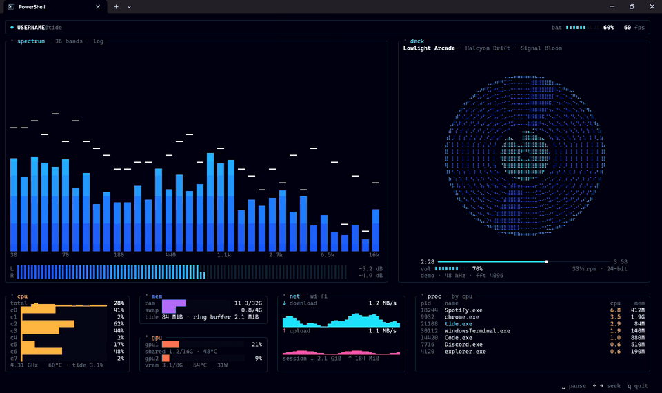

<h1 align="center">
  &nbsp;tide
</h1>

<p align="center">
  <b>A terminal music visualizer and system monitor for Windows Terminal.</b><br>
  Whatever your PC is playing, drawn live — next to your CPU, GPU, memory and network.
</p>

<p align="center">
  <a href="https://github.com/Deep7k/tide/releases/latest"></a>
  <a href="https://github.com/Deep7k/tide/actions/workflows/ci.yml"></a>
  
  
  <a href="LICENSE"></a>
</p>

<p align="center">
  
</p>

<p align="center">
  <a href="#quick-start">Quick start</a> ·
  <a href="#keys-and-options">Keys</a> ·
  <a href="#configuration">Configuration</a> ·
  <a href="#themes">Themes</a> ·
  <a href="#troubleshooting">Troubleshooting</a> ·
  <a href="docs/README.md">Technical docs</a>
</p>

---

## Features

| Panel | What it shows |
| --- | --- |
| **spectrum** | 36 log-spaced bands from 30 Hz to 16 kHz with falling peak caps, plus stereo VU meters |
| **deck** | The current track from Windows' media controls, a spinning braille record, progress and volume |
| **cpu** | Total and per-core load (physical cores) and the effective clock |
| **mem** | RAM, swap and tide's own footprint |
| **gpu** | Every GPU — integrated and discrete — with load, memory and temperature |
| **net** | Download and upload rates with graphs for the active interface |
| **proc** | The busiest programs by CPU or memory |
| **top panel** | `user@host`, battery and frame rate |

- **Works with anything that plays sound** — Spotify, browsers, games — through WASAPI loopback, and follows you when you switch to headphones or Bluetooth.
- **Controls your music**: play/pause and seek whatever Windows treats as the current media session.
- **Light**: typically under 1% CPU while music plays, much less when idle.
- **One ~2 MB `.exe`** with no runtime dependencies. Themes and every setting live in an optional TOML file.

## Quick start

1. Download `tide-vX.Y.Z-windows-x64.zip` from the [latest release](https://github.com/Deep7k/tide/releases/latest) and unzip it.
2. Open **Windows Terminal**, maximise it, and run:
   ```powershell
   .\tide.exe
   ```
3. Play some music.

Each release has a `.sha256` file to check the download:
`(Get-FileHash tide-vX.Y.Z-windows-x64.zip -Algorithm SHA256).Hash`

**Requirements**

- Windows 10 or 11
- [Windows Terminal](https://aka.ms/terminal) (recommended; any terminal with 24-bit colour works)
- A font with block and braille characters, such as **Cascadia Mono** (ships with Windows Terminal) or JetBrains Mono
- Room to draw: the full design is **165×42** cells. Smaller windows still work — panels shrink and drop out down to about 90×24, and bigger ones fill the space.

## Keys and options

| Key | Action |
| --- | --- |
| <kbd>Space</kbd> | Play / pause the current media (Spotify, browser, …) |
| <kbd>←</kbd> <kbd>→</kbd> | Seek back / forward 5 s |
| <kbd>Q</kbd>, <kbd>Esc</kbd>, <kbd>Ctrl</kbd>+<kbd>C</kbd> | Quit |

| Option | |
| --- | --- |
| `--config PATH` | Use this settings file (default: `%APPDATA%\tide\config.toml` if it exists) |
| `--print-config` | Print every setting with its default and a comment |
| `--fps N` | Frame rate (overrides the config) |
| `--demo` | Fake data everywhere — no audio capture or system access |
| `-V`, `--version` | Print the version |

## Configuration

Settings come from built-in defaults, then the config file, then command-line
flags. Every key is optional, so a config only needs what you change. Start from
the full default config:

```powershell
New-Item -ItemType Directory -Force $env:APPDATA\tide | Out-Null
tide.exe --print-config > $env:APPDATA\tide\config.toml
```

Typos are reported as warnings (shown after tide exits), invalid values as errors
naming the key, and syntax errors with the line and column. UTF-8 and UTF-16 files
both work.

<details>
<summary><b>The most useful settings</b></summary>

| Key | Default | |
| --- | --- | --- |
| `fps` / `idle_fps` | 60 / 10 | Frame rate, and the rate while nothing moves (no sound, record stopped) |
| `theme` | `"tide"` | See [Themes](#themes) |
| `audio.agc` | `true` | Automatic gain so quiet tracks still fill the bars; `false` = fixed scale up to 0 dBFS |
| `audio.range_db` | 40 | dB range from the bottom to the top of the bars |
| `audio.attack` / `release` | 0.6 / 0.15 | Bar smoothing (higher = snappier) |
| `spectrum.max_bands` | 36 | Bands at full width |
| `spectrum.max_rows` | 0 | Spectrum height cap; 0 fills the terminal, 18 is the original design |
| `media.seek_seconds` | 5 | Seek step |
| `stats.proc_sort` | `"cpu"` | `"cpu"` or `"mem"` |
| `stats.proc_hide` | `["System", "Registry", "Memory Compression"]` | Process names to leave out |
| `stats.gpus` | `"all"` | `"all"`, `"discrete"`, `"integrated"`, or names in display order, e.g. `["t1200", "uhd"]` |
| `stats.gpu_source` | `"auto"` | When to ask NVIDIA's driver for watts (`"auto"` only while the GPU is busy, so an idle laptop GPU can sleep) |
| `stats.net_units` | `"bytes"` | `"bits"` shows Mbps like Task Manager |
| `stats.temp_unit` | `"c"` | `"c"` or `"f"` |

`--print-config` lists every key with an explanation.

</details>

## Themes

`theme` in the config is one of:

- `"tide"` — the built-in theme
- a name, loading `%APPDATA%\tide\themes\<name>.toml`
- a path to a `.toml` file (relative to the config file)

A theme file sets any subset of these colours as `"#RRGGBB"`; the rest come from
`tide`: `bg`, `border`, `track`, `dim`, `text`, `hi`, `accent`, `viz` (gradient,
2+ colours, bottom to top), `record_label`, `record_rim`, `record_groove`, `cpu`,
`cpu_hot`, `mem`, `gpu`, `net_down`, `net_up`, `battery`.

```toml
# %APPDATA%\tide\themes\rose.toml
accent = "#FF5EA8"
viz = ["#3B0A45", "#8E2DE2", "#FF5EA8", "#FFD1E8"]
```

### Windows Terminal colour scheme

tide paints its own background, but a matching scheme makes the window edges
blend in. Add this to `schemes` in Windows Terminal's `settings.json` and set
`"colorScheme": "Tide"` on a profile. For a dedicated tide profile,
`"scrollbarState": "hidden"` and `"padding": "0"` let the panels reach the edges.

<details>
<summary><b>Tide scheme JSON</b></summary>

```json
{
  "name": "Tide",
  "background": "#070B10",
  "foreground": "#CFDBE6",
  "cursorColor": "#22E0FF",
  "selectionBackground": "#1C2733",
  "black": "#16212C",
  "red": "#FF5EA8",
  "green": "#7CF2C4",
  "yellow": "#FFB547",
  "blue": "#2A9BFF",
  "purple": "#B56CFF",
  "cyan": "#22E0FF",
  "white": "#CFDBE6",
  "brightBlack": "#5A6B7D",
  "brightRed": "#FF7A59",
  "brightGreen": "#A6FFDC",
  "brightYellow": "#FFD08A",
  "brightBlue": "#6CC0FF",
  "brightPurple": "#CF9BFF",
  "brightCyan": "#A8FBFF",
  "brightWhite": "#F2FBFF"
}
```

</details>

## Troubleshooting

**No bars, or "audio capture: …" in the footer.** tide captures the default output
device and follows it within a second or two when you switch (headphones,
Bluetooth). `tide --probe-audio` captures 5 s and prints what it sees.

**`space` or `← →` say "… doesn't support seeking" or "no media playing".** Commands
go to whichever app Windows treats as the current media session (the one in the
volume flyout). Some apps ignore seek requests.

**No GPU temperature or watts.** Temperature comes from Windows and appears only
if the driver reports it. Watts need an NVIDIA GPU and, with the default
`gpu_source = "auto"`, only appear while that GPU is busy.

**The record looks ragged.** The font is missing braille characters or mixing in a
fallback font; switch to Cascadia Mono.

**CPU use.** Lower `fps` for more savings. `tide --probe-stats` shows the readings
and what sampling costs.

## Building from source

You need the MSVC build tools and Rust.

1. Install the C++ build tools (no Visual Studio IDE needed):
   ```powershell
   winget install --id Microsoft.VisualStudio.BuildTools --override "--passive --wait --add Microsoft.VisualStudio.Workload.VCTools --includeRecommended"
   ```
2. Install Rust from [rustup.rs](https://rustup.rs). The version is pinned in
   `rust-toolchain.toml`, so the right one is picked up automatically.

   This repo can also keep Rust entirely inside the project folder, like a Python
   venv: install with `RUSTUP_HOME` and `CARGO_HOME` pointing at `.toolchain\` and
   `--no-modify-path`, then activate it in each shell with `. .\env.ps1`. VS Code
   terminals and rust-analyzer pick it up through `.vscode/settings.json`.
3. Build:
   ```powershell
   cargo build --release
   ```
   The binary is `target\release\tide.exe`, with the tide icon and version info
   embedded. Release builds use link-time optimisation, so they take a few minutes
   from clean.

## Development

```powershell
cargo test                   # unit tests + saved-frame snapshots
cargo clippy --all-targets
cargo run -- --demo          # fake data, no capture
```

The snapshot tests render demo frames at 165×42 and 120×30 and compare them with
`snapshots/`. After an intended visual change, re-save them with
`$env:TIDE_BLESS = 1; cargo test snapshot; Remove-Item Env:TIDE_BLESS`.

| Diagnostic flag | |
| --- | --- |
| `--dump WxH` | Print one demo frame as plain text |
| `--bench WxH` | Time off-screen rendering per panel and bytes per frame |
| `--profile FILE --quit-after N` | Run live for N seconds, then write per-phase timings and process CPU to FILE |
| `--probe-audio` / `--probe-stats` / `--probe-media` | Print what each data source reads right now |

How it all works — threads, audio pipeline, system stats, rendering, CI and
releases — is in the [technical docs](docs/README.md).

## License

[MIT](LICENSE) © 2026 Deepak N A
